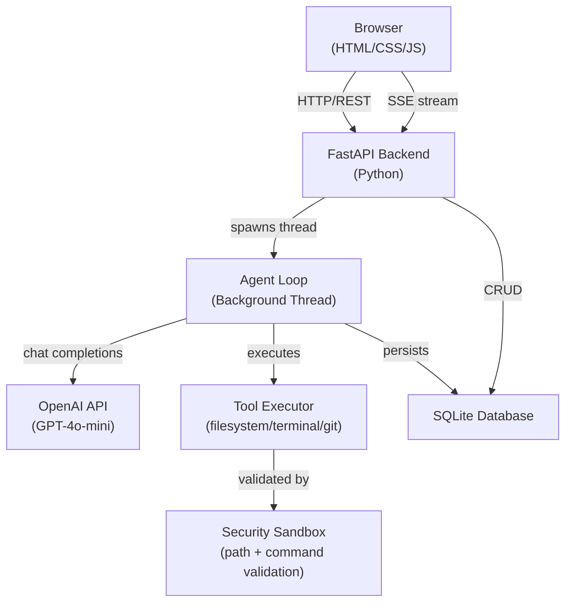
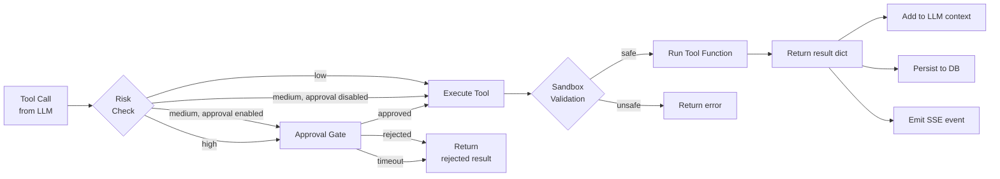
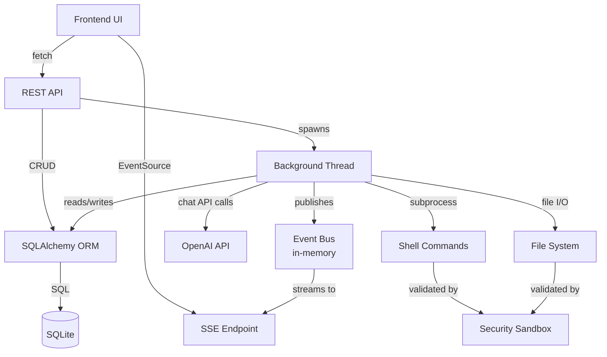
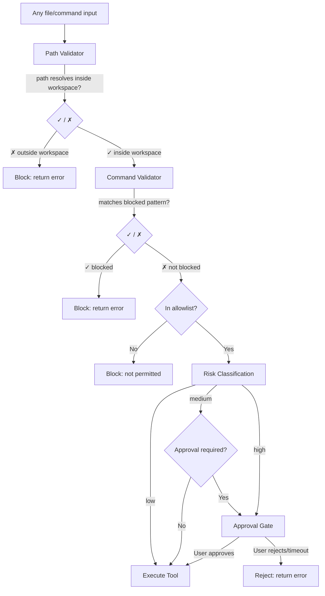

# CodePilot Agent — Architecture Documentation

## 1. Application Architecture



## 2. Agent Execution Loop

```mermaid
sequenceDiagram
    participant U as User
    participant UI as Frontend
    participant API as FastAPI
    participant Loop as AgentLoop
    participant LLM as OpenAI LLM
    participant Tools as Tool Executor
    participant DB as SQLite

    U->>UI: Submit task prompt
    UI->>API: POST /api/agent/tasks
    API->>DB: Save task (status=pending)
    API->>Loop: Start background thread
    API-->>UI: Return task_id
    UI->>API: GET /api/agent/tasks/{id}/events (SSE)

    Loop->>LLM: Generate plan
    LLM-->>Loop: Plan JSON
    Loop->>DB: Save plan
    Loop-->>UI: plan_generated event

    loop up to 12 iterations
        Loop->>LLM: chat(messages + tools)
        LLM-->>Loop: tool_call or text
        
        alt tool_call
            Loop->>Loop: Check risk level
            alt high risk
                Loop-->>UI: approval_requested event
                U->>API: POST /api/approvals/{id}/decide
                API->>Loop: Signal (approved/rejected)
            end
            Loop->>Tools: Execute tool
            Tools-->>Loop: Result dict
            Loop->>DB: Save tool execution
            Loop->>LLM: Add tool result to context
            Loop-->>UI: tool_completed event
        else text response
            Loop-->>UI: agent_message event
        end
    end

    Loop->>DB: Save final response
    Loop-->>UI: task_completed event
    UI->>UI: Render final message + file changes
```

## 3. Tool Execution Workflow



## 4. Human Approval Workflow

```mermaid
sequenceDiagram
    participant Loop as AgentLoop
    participant DB as SQLite
    participant Svc as ApprovalService
    participant API as FastAPI
    participant UI as Frontend
    participant User as User

    Loop->>DB: Create ApprovalRequest (status=pending)
    Loop->>Svc: register(approval_id)
    Loop->>UI: approval_requested SSE event
    UI->>UI: Render approval card in chat
    Note over Loop: Thread blocks on threading.Event

    User->>UI: Click Approve / Reject
    UI->>API: POST /api/approvals/{id}/decide
    API->>DB: Update status
    API->>Svc: signal(approval_id, decision)
    Svc->>Loop: Unblock thread
    
    alt approved
        Loop->>Loop: Execute tool
    else rejected
        Loop->>Loop: Return rejected result to LLM
    end
```

## 5. Data Flow



## 6. Security Model



## Component Descriptions

### AgentLoop (`app/agent/loop.py`)
The core execution engine. Runs in a background thread with its own SQLAlchemy session. Drives the plan-generate → LLM-step → tool-call → result-feed cycle. Publishes SSE events at each stage. Checks a cancellation flag before each iteration.

### LLMClient (`app/agent/llm_client.py`)
Wraps the OpenAI Python SDK. Sends chat completion requests with tool/function schemas. Normalises the response to a standard dict. Handles authentication, rate limit, and connection errors with descriptive messages.

### AgentContext (`app/agent/context.py`)
Maintains the growing list of messages sent to the LLM. Automatically prepends the system prompt. Truncates very long tool results (>8000 chars) to prevent context window overflow. Trims to the most recent 60 messages.

### TaskPlanner (`app/agent/planner.py`)
Asks the LLM to generate a JSON step list for the given task. Falls back to a default 4-step plan if the LLM fails or returns invalid JSON. Provides helpers to advance step statuses as the loop progresses.

### Security Sandbox (`app/security/sandbox.py`)
`validate_path` resolves the path to an absolute path and raises `ValueError` if it doesn't start with the workspace root. `validate_command` checks against an allowlist of prefixes and a blocklist of regex patterns. `get_tool_risk` maps tool names to low/medium/high.

### EventBus (`app/services/event_bus.py`)
In-memory pub/sub. The agent loop calls `publish()` (synchronous, from a thread). The SSE endpoint calls `stream()` (async generator). New SSE subscribers receive a replay of the last 200 events for the task.

### ApprovalService (`app/services/approval_service.py`)
Uses `threading.Event` to let the agent loop block until the user decides. The API endpoint calls `signal()` which unblocks the waiting thread. 5-minute timeout prevents the agent from waiting indefinitely.
